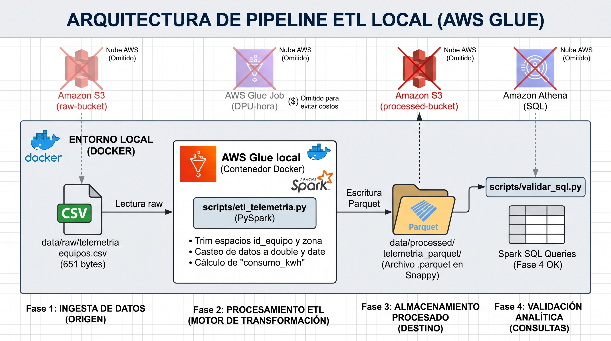
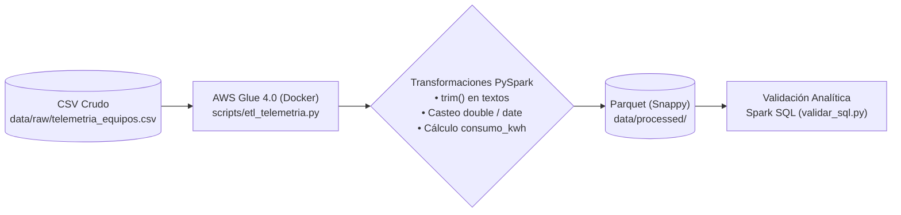
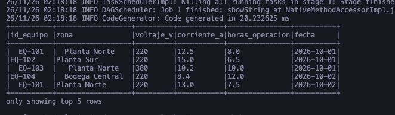
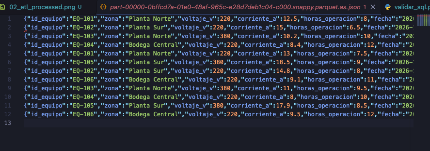

# Pipeline ETL con AWS Glue 4.0 (PySpark) y Docker

<p>
  
  
  
  
</p>

Pipeline ETL desarrollado como práctica de diplomatura en Data Science para procesar telemetría energética de equipos industriales. Utiliza la imagen oficial de **AWS Glue (`amazon/aws-glue-libs`)** en Docker para desarrollar, transformar y validar datos localmente antes de su despliegue en la nube.

---

## Arquitectura del Flujo





---

## Transformación: Antes vs. Después

**Datos crudos (`telemetria_equipos.csv`):** espacios inconsistentes en textos, tipos como `string` y sin métrica energética.

| id_equipo | zona | voltaje_v | corriente_a | horas_operacion | fecha |
| :--- | :--- | :--- | :--- | :--- | :--- |
| `  EQ-101 ` | `  Planta Norte  ` | `220` | `12.5` | `8.0` | `2026-10-01` |
| `EQ-102  ` | `Planta Sur   ` | `220` | `15.0` | `6.5` | `2026-10-01` |

**Datos procesados (`Parquet`):** textos normalizados, tipos estrictos (`double`, `date`) y columna derivada `consumo_kwh = round((voltaje_v * corriente_a / 1000) * horas_operacion, 2)`.

| id_equipo | zona | voltaje_v | corriente_a | horas_operacion | fecha | consumo_kwh |
| :--- | :--- | :--- | :--- | :--- | :--- | :--- |
| `EQ-101` | `Planta Norte` | `220.0` | `12.5` | `8.0` | `2026-10-01` | **22.0** |
| `EQ-102` | `Planta Sur` | `220.0` | `15.0` | `6.5` | `2026-10-01` | **21.45** |

---

## Estructura del Proyecto

```text
.
├── data/
│   ├── raw/
│   │   └── telemetria_equipos.csv       # Dataset de entrada con espacios sucios
│   └── processed/
│       └── telemetria_parquet/          # Salida columnar Parquet (Snappy)
├── docs/
│   └── captures/
│       ├── 00_arquitectura.jpeg         # Diagrama de arquitectura del pipeline
│       ├── 01_etl_raw.png               # Evidencia datos crudos
│       ├── 02_etl_processed.png         # Evidencia datos transformados
│       ├── 03_salida_parquet.png        # Evidencia archivo Parquet
│       └── 04_validacion_sql.png        # Evidencia consultas Spark SQL
├── scripts/
│   ├── etl_telemetria.py                # Job ETL en PySpark / AWS Glue
│   └── validar_sql.py                   # Consultas analíticas con Spark SQL
├── docker-compose.yml                   # Contenedor oficial amazon/aws-glue-libs
├── requirements.txt                     # Dependencias de referencia local
└── README.md
```

---

## Cómo ejecutar el proyecto localmente

Requiere únicamente **Docker** y **Docker Compose**.

```bash
# 1. Levantar el contenedor oficial de AWS Glue 4.0
docker compose up -d

# 2. Ejecutar el job ETL (CSV -> Parquet)
docker compose exec glue-local /home/glue_user/spark/bin/spark-submit /home/glue_user/workspace/scripts/etl_telemetria.py

# 3. Ejecutar validación analítica con Spark SQL
docker compose exec glue-local /home/glue_user/spark/bin/spark-submit /home/glue_user/workspace/scripts/validar_sql.py

# 4. Detener el entorno al finalizar
docker compose down
```

---

## Evidencia de Ejecución

<details>
<summary><strong>1. Ejecución del Job ETL en PySpark (Antes y Después)</strong></summary>
<br>
<p><strong>Datos crudos (RAW):</strong></p>

<br><br>
<p><strong>Datos transformados (PROCESSED):</strong></p>

</details>

<details>
<summary><strong>2. Generación de archivos columnares Parquet (Snappy)</strong></summary>
<br>

</details>

<details>
<summary><strong>3. Validación analítica con Spark SQL</strong></summary>
<br>

</details>